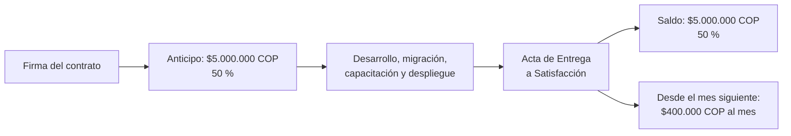
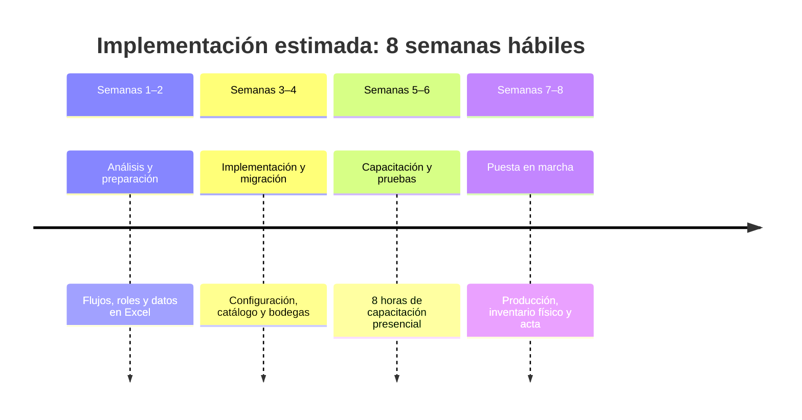
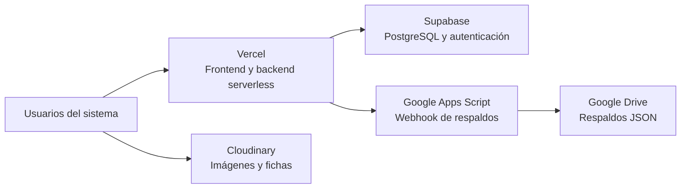

# Borrador de contrato de servicios tecnológicos

## Sistema de Gestión Integral de Inventario y Comercial — A&L Compresores y Partes

**Estado:** Borrador técnico-operativo para revisión y formalización de las Partes

**Revisión documental:** 28 de octubre de 2026

**Proyecto Base de Datos e Infraestructura:** Supabase (PostgreSQL), Vercel Serverless, Cloudinary y Google Drive

> **Aviso:** Este documento constituye una base contractual y técnica adaptada a los requerimientos, arquitectura y propuesta comercial de A&L Compresores y Partes. No reemplaza la asesoría jurídica individualizada y debe ser revisado por un abogado titulado bajo la legislación colombiana antes de su suscripción definitiva.

---

## Vista rápida del acuerdo

| Implementación | Mantenimiento mensual | Plazo estimado | Capacitación |
|---:|---:|---:|---:|
| **$10.000.000 COP** | **$400.000 COP** | **8 semanas hábiles** | **8 horas** |

### Hitos de pago

### Recorrido del proyecto

### Vista de infraestructura

<strong>Mostrar índice de cláusulas</strong>

1. [Partes](#1-partes)
2. [Objeto y modalidad del servicio](#2-objeto-y-modalidad-del-servicio)
3. [Alcance funcional, entregables y módulos contratados](#3-alcance-funcional-entregables-y-modulos-contratados)
4. [Obligaciones de las Partes](#4-obligaciones-de-las-partes)
5. [Infraestructura, servicios de terceros y contingencia de datos](#5-infraestructura-servicios-de-terceros-y-contingencia-de-datos)
6. [Procedimiento de aceptación y entrega](#6-procedimiento-de-aceptacion-y-entrega)
7. [Precio, forma de pago e impuestos](#7-precio-forma-de-pago-e-impuestos)
8. [Acuerdos de nivel de servicio (SLA) y soporte](#8-acuerdos-de-nivel-de-servicio-sla-y-soporte)
9. [Cronograma de ejecución](#9-cronograma-de-ejecucion)
10. [Propiedad intelectual y derechos sobre el software](#10-propiedad-intelectual-y-derechos-sobre-el-software)
11. [Confidencialidad y protección de datos (Habeas Data)](#11-confidencialidad-y-proteccion-de-datos-habeas-data)
12. [Independencia laboral](#12-independencia-laboral)
13. [Vigencia y terminación](#13-vigencia-y-terminacion)
14. [Solución de controversias y ley aplicable](#14-solucion-de-controversias-y-ley-aplicable)
15. [Firmas y aceptación](#15-firmas-y-aceptacion)

> **Lectura contractual:** los gráficos y el índice son recursos de navegación. Las cláusulas completas de este documento prevalecen ante cualquier diferencia de interpretación.

---

## 1. Partes

Entre los suscritos:

**EL PROVEEDOR (Equipo Desarrollador):**

Equipo ejecutor técnico conformado de manera conjunta por:

* **Julian Felipe Muñoz Vesga**, identificado con C.C. No. `[Completar]`, con domicilio en Bogotá D.C., quien actúa como Líder Técnico;
* **Juan Camilo Cadena Barragan**, identificado con C.C. No. `[Completar]`;
* **Dilan Jesus Wilches Hernandez**, identificado con C.C. No. 1013609315;
* **Cristofer Smith Osuna Barragán**, identificado con C.C. No. `[Completar]`.

**EL CLIENTE:**

**A&L COMPRESORES Y PARTES**, sociedad comercial identificada con el **NIT 9016121185**, con domicilio principal en Bogotá D.C., Colombia, representada legalmente por el señor **ALFRED VESGA**, identificado con C.C. No. `[Completar]`.

En conjunto, “las Partes”.

---

## 2. Objeto y modalidad del servicio

**EL PROVEEDOR** se compromete a prestar a favor de **EL CLIENTE** los servicios profesionales independientes de diseño, parametrización, desarrollo, migración de datos históricos, despliegue en infraestructura nube, capacitación y puesta en marcha del software denominado **"Sistema de Gestión Integral de Inventario y Comercial — A&L Compresores y Partes"**.

La entrega del software operará bajo la modalidad de desarrollo a la medida con despliegue en arquitectura desacoplada (Frontend SPA en Vite/React y Backend Serverless en Node.js sobre Vercel, conectado a Supabase PostgreSQL y almacenamiento en Google Drive y Cloudinary). Ningún servicio o infraestructura no contemplado expresamente en este contrato o sus anexos se entenderá incluido.

---

## 3. Alcance funcional, entregables y módulos contratados

El alcance operativo del sistema comprende estrictamente los siguientes componentes:

1. **Módulo 1: Control Centralizado de Inventario y Ficha de Productos:**
* Registro de catálogo maestro con referencia interna, nombre, proveedor, marca, tipo y unidad de medida.
* Control de existencias en tiempo real y visualización prioritaria de componentes de alta rotación (filtros, separadores, aceites y repuestos de compresores).

2. **Módulo 2: Gestión de Ubicaciones Físicas y Bodegas:**
* Registro obligatorio de la ubicación física en estantería/bodega para cada ítem almacenado.
* Filtros de búsqueda por bodega y módulo de registro de traslados internos de mercancía.

3. **Módulo 3: Alertas Automáticas, Valoración y Reportes:**
* Alertas visuales y métricas automáticas ante niveles de stock crítico (menos de 10 unidades).
* Cálculo automático de la valoración monetaria del inventario consolidado en pesos colombianos (COP).

4. **Módulo 4: Gestión de Usuarios, Roles y Trazabilidad:**
* Esquema de autenticación y autorización diferenciada: Administrador (Nivel Máster) y Auxiliar Operativo.
* Trazabilidad y auditoría de transacciones por usuario en la tabla de movimientos de stock.

5. **Módulo 5: Subsistema Integrado de Respaldos (Disaster Recovery):**
* Módulo interactivo en el panel (`DashboardHome.jsx`) y endpoint backend (`/api/backup/generar-respaldo-drive`) para la extracción empaquetada de las 13 tablas relacionales de Supabase (`bodega`, `carrito`, `carrito_item`, `favoritos`, `notificaciones_stock`, `orden`, `orden_item`, `producto_bodega`, `productos`, `resenas_producto`, `reserva`, `stock_movimiento`, `usuario`) y su depósito seguro en formato JSON fechado dentro del Google Drive corporativo de **EL CLIENTE** vía Google Apps Script Webhook.

---

## 4. Obligaciones de las Partes

### 4.1 EL PROVEEDOR

1. Desarrollar e integrar los módulos descritos en el numeral 3 conforme a las especificaciones técnicas acordadas.
2. Realizar la limpieza y migración de los datos maestros desde los archivos Excel entregados por **EL CLIENTE**.
3. Dictar ocho (8) horas de capacitación presencial distribuidas entre los usuarios clave y administradores de A&L Compresores y Partes.
4. Entregar el manual digital de usuario y la guía técnica de operación del sistema.
5. Guardar estricta reserva y confidencialidad sobre inventarios, precios de compra/venta y clientes de **EL CLIENTE**.

### 4.2 EL CLIENTE

1. Suministrar de manera oportuna la información, listados de precios, catálogo de productos e inventarios iniciales en hojas de cálculo para la fase de migración.
2. Disponer del tiempo y la asistencia del personal operativo y administrativo para las sesiones de capacitación.
3. Custodiar los usuarios, contraseñas de administradores y credenciales de acceso creadas en el sistema.
4. Efectuar las pruebas de aceptación y suscribir el **Acta de Entrega a Satisfacción** dentro de los plazos estipulados.
5. Realizar oportunamente los pagos de implementación y los cánones mensuales acordados.

---

## 5. Infraestructura, servicios de terceros y contingencia de datos

El sistema utiliza proveedores externos de infraestructura en la nube bajo los esquemas configurados para el proyecto:

1. **Base de Datos y Autenticación (Supabase):** Aloja la base de datos PostgreSQL bajo el plan operativo configurado. Las partes reconocen que las copias de seguridad de contingencia dependen del subsistema de respaldo externo a Google Drive implementado por el Proveedor.
2. **Hospedaje de Aplicación (Vercel):** Aloja el frontend y procesa las peticiones de backend mediante arquitectura Serverless.
3. **Imágenes y Catálogos Multimedia (Cloudinary):** Aloja las fotografías de repuestos y fichas técnicas. El uso ordinario se encuentra dentro de las cuotas del plan asignado; cualquier ampliación requerida por el volumen del catálogo de **EL CLIENTE** deberá ser autorizada previamente por este.
4. **Almacenamiento de Respaldos (Google Drive / Google Apps Script):** Canal de recepción automatizado de copias JSON corporativas. La administración y propiedad de dicha cuenta de Drive corresponde a **EL CLIENTE**.

---

## 6. Procedimiento de aceptación y entrega

La entrega del software se formalizará mediante un **Acta de Entrega a Satisfacción** suscrita por Alfred Vesga o el delegado que este designe, una vez cumplido el siguiente protocolo:

1. Despliegue operativo y funcional de la plataforma en el dominio de producción.
2. Verificación de la carga completa de los datos migrados desde Excel.
3. Culminación de las ocho (8) horas de capacitación presencial y entrega de manuales.
4. Ejecución exitosa de una prueba real de respaldo desde el botón del panel hacia Google Drive.
5. **EL CLIENTE** dispondrá de un término de cinco (5) días hábiles posteriores al despliegue para comunicar por escrito cualquier defecto o discrepancia funcional respecto a lo pactado. Subsanados los requerimientos, se firmará el acta definitiva.

---

## 7. Precio, forma de pago e impuestos

### 7.1 Valor de Implementación (Pago Único)

El valor total por los servicios de desarrollo, migración, parametrización, capacitación y despliegue inicial es de **DIEZ MILLONES DE PESOS MONEDA CORRIENTE ($10.000.000 COP)**, pagaderos así:

* **Anticipo (50%):** **CINCO MILLONES DE PESOS COP ($5.000.000 COP)** a la firma del presente contrato, para dar inicio a la Fase 1.
* **Saldo Final (50%):** **CINCO MILLONES DE PESOS COP ($5.000.000 COP)** pagaderos a la firma del Acta de Entrega a Satisfacción y salida formal a producción.

### 7.2 Servicio Mensual de Mantenimiento y Operación

A partir del mes siguiente a la entrega formal a satisfacción, **EL CLIENTE** pagará una tarifa mensual fija de **CUATROCIENTOS MIL PESOS MONEDA CORRIENTE ($400.000 COP)** vencidos, que incluye:

* Monitoreo de disponibilidad de la plataforma en la nube (Vercel y Supabase).
* Verificación técnica de la integridad del webhook de respaldos hacia Google Drive.
* Dos (2) mantenimientos preventivos mensuales programados en horario no hábil.
* Soporte técnico y corrección de incidencias operativas.

---

## 8. Acuerdos de nivel de servicio (SLA) y soporte

El soporte técnico se prestará a través de los canales autorizados (`soporte@alcompresores.com` y canal de mensajería directa) en el horario:

* **Lunes a Viernes:** 8:00 AM – 6:00 PM
* **Sábados:** 10:00 AM – 6:00 PM

| Nivel de Severidad | Criterio Operativo | Tiempo Máximo de Respuesta | Tiempo Máximo de Solución |
| --- | --- | --- | --- |
| **Crítica** | Caída general del sistema o inaccesibilidad total del panel | 2 horas | 4 horas |
| **Alta** | Falla que impide registrar inventario, stock o consultar bodegas | 4 horas | 24 horas |
| **Media** | Falla en reportería, alertas o filtros que no detiene la operación | 8 horas | 48 horas |
| **Baja** | Consultas generales de uso, dudas o ajustes visuales menores | 24 horas | 5 días hábiles |

*Parágrafo:* En domingos y festivos la atención se limitará de manera exclusiva a incidentes de severidad **Crítica**.

---

## 9. Cronograma de ejecución

El proyecto se ejecutará en un plazo estimado de **ocho (8) semanas hábiles** (40 días hábiles):

* **Fase 1: Análisis y Preparación (Semanas 1-2):** Kickoff directivo, levantamiento de flujos, definición de roles y preparación de datos en Excel.
* **Fase 2: Implementación y Migración (Semanas 3-4):** Configuración en nube, migración de catálogo maestro de repuestos, parametrización de bodegas y pruebas internas de consistencia.
* **Fase 3: Capacitación y Pruebas Asistidas (Semanas 5-6):** Sesiones de capacitación presencial (8 horas totales), pruebas de usuario con personal auxiliar y afinamiento de interfaz.
* **Fase 4: Puesta en Marcha (Semanas 7-8):** Salida a producción, acompañamiento en toma física de inventario y firma del Acta de Cierre.

---

## 10. Propiedad intelectual y derechos sobre el software

1. **Propiedad Patrimonial:** Una vez cancelado el 100% del valor de implementación ($10.000.000 COP), la propiedad patrimonial del código desarrollado a la medida para A&L Compresores y Partes pertenecerá a **EL CLIENTE** para su uso y explotación exclusiva.
2. **Propiedad de los Datos:** Todos los datos, inventarios, cifras, registros de stock, clientes y movimientos comerciales almacenados en Supabase o respaldados en Google Drive son de propiedad exclusiva de **EL CLIENTE**.
3. **Derechos Morales:** De conformidad con la Ley 23 de 1982 y la Decisión 351 de la CAN, los integrantes de **EL PROVEEDOR** conservan el derecho moral de autoría sobre el desarrollo tecnológico.

---

## 11. Confidencialidad y protección de datos (Habeas Data)

1. **Confidencialidad:** Las Partes acuerdan que toda información técnica, financiera, de costos, de clientes o inventarios intercambiada con ocasión de este contrato tendrá carácter estrictamente confidencial.
2. **Tratamiento de Datos:** **EL PROVEEDOR** actuará en calidad de Encargado del Tratamiento respecto a las bases de datos de clientes y empleados cargadas en el sistema, obligándose a cumplir con los lineamientos de la Ley Estatutaria 1581 de 2012 de Colombia, limitándose a tratar los datos según las instrucciones de **EL CLIENTE** y garantizando medidas técnicas para prevenir su adulteración, pérdida o acceso no autorizado.

---

## 12. Independencia laboral

El presente contrato es de naturaleza mercantil e independiente. No genera relación laboral, vínculo de subordinación, prestaciones sociales ni obligaciones de carácter laboral entre **EL CLIENTE** y los integrantes de **EL PROVEEDOR**.

---

## 13. Vigencia y terminación

1. **Vigencia:** El contrato tendrá una vigencia inicial equivalente al periodo de desarrollo (8 semanas) y se prorrogará automáticamente de forma mensual respecto al servicio de soporte y mantenimiento estipulado en la Cláusula 7.2.
2. **Terminación del Soporte:** Cualquiera de las partes podrá dar por terminado el servicio mensual de soporte mediante aviso escrito con una antelación mínima de treinta (30) días calendario.
3. **Efectos de Terminación:** A la terminación del contrato, **EL PROVEEDOR** garantizará la entrega del último volcado íntegro de la base de datos en formato JSON y el traspaso formal de credenciales y accesos maestros a nombre de **EL CLIENTE**.

---

## 14. Solución de controversias y ley aplicable

El presente contrato se rige e interpreta bajo las leyes de la República de Colombia. Cualquier discrepancia derivada de su ejecución o liquidación que no pueda resolverse amigablemente dentro de los quince (15) días hábiles siguientes a la notificación de la diferencia, será sometida a conciliación extrajudicial en derecho ante un Centro de Conciliación legalmente reconocido en la ciudad de Bogotá D.C.

---

## 15. Firmas y aceptación

Para constancia de lo acordado, las Partes suscriben el presente documento en dos (2) ejemplares de idéntico valor y tenor en la ciudad de Bogotá D.C., a los `[Día]` días del mes de `[Mes]` de 2026.

---

**ALFRED VESGA**

C.C. No. `[Completar]`

Representante Legal

**A&L COMPRESORES Y PARTES**

NIT 9016121185

*EL CLIENTE*

---

**JULIAN FELIPE MUÑOZ VESGA**

C.C. No. `[Completar]`

Líder Técnico

*EL PROVEEDOR*

---

**JUAN CAMILO CADENA BARRAGÁN **

C.C. No. 1013120113

*EL PROVEEDOR*

---

**DILAN JESUS WILCHES HERNANDEZ**

C.C. No. 1013609315
*EL PROVEEDOR*

---

**CRISTOFER SMITH OSUNA BARRAGÁN**

C.C. No. `[Completar]`

*EL PROVEEDOR*